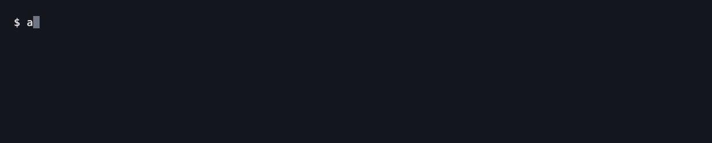

# anigrass

[Annict](https://annict.com/) のエピソード視聴記録を、GitHub の草のようにターミナルへ表示する CLI ツールです。



## インストール

### Go

Go 1.27 以降が必要です。

```sh
go install github.com/furudenipa/anigrass@latest
```

### GitHub Releases

[Releases](https://github.com/furudenipa/anigrass/releases/latest) から OS・CPU に合うアーカイブをダウンロードし、展開した `anigrass`（Windows は `anigrass.exe`）を PATH の通ったディレクトリに配置してください。

## 使い方

[Annict 個人用アクセストークン](https://annict.com/settings/tokens/new)（読み取り専用）を発行し、環境変数に設定して実行します。

```sh
export ANNICT_ACCESS_TOKEN="YOUR_TOKEN"

anigrass

# ユーザー指定・合計件数の表示
anigrass --user frdnp --total

# 期間指定・各ラベルの表示
anigrass --from 2026-01-01 --to 2026-10-30 --show-weekdays --show-months --show-legend

# ライトテーマ・カスタム文字の指定
anigrass --theme light --grass '●'

```

### 主なオプション

| オプション | 説明 | 既定値 |
| --- | --- | --- |
| `-u`, `--user` | Annict ユーザー名 | トークン所有者 |
| `--from` | 開始日 (`YYYY-MM-DD`) | 終了日の364日前 |
| `--to` | 終了日 (`YYYY-MM-DD`) | 今日 |
| `--timezone` | 集計タイムゾーン | `Asia/Tokyo` |
| `-t`, `--theme` | テーマ (`dark` / `light`) | `dark` |
| `-g`, `--grass` | カラー表示時の草文字 | `■` |
| `--total` | 合計視聴数を表示 | 無効 |
| `--show-weekdays` | 曜日ラベルを表示 | 無効 |
| `--show-months` | 月ラベルを表示 | 無効 |
| `--show-legend` | 凡例を表示 | 無効 |
| `--no-color` | 色なし表示 | 無効 |

※ `NO_COLOR` 環境変数、`TERM=dumb`、パイプ出力時には自動で色なし表示（`· ░ ▒ ▓ █`）へ切り替わります。

## 仕様・集計条件

* **集計対象**: エピソード視聴記録（1記録 = 1カウント）。作品レビューやステータス変更は除外されます。
* **日付基準**: 記録の作成日時（`createdAt`）を指定タイムゾーンで判定します。

## ライセンス

[MIT License](LICENSE)。依存ライブラリのライセンスは [THIRD_PARTY_NOTICES](THIRD_PARTY_NOTICES) を参照してください。
